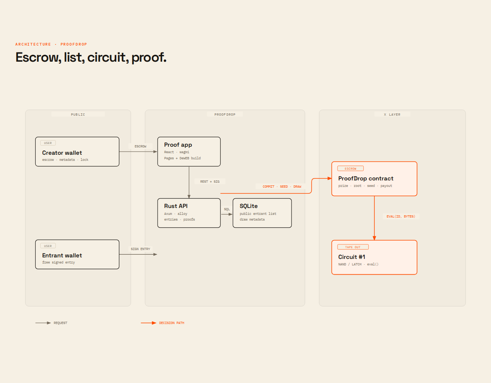
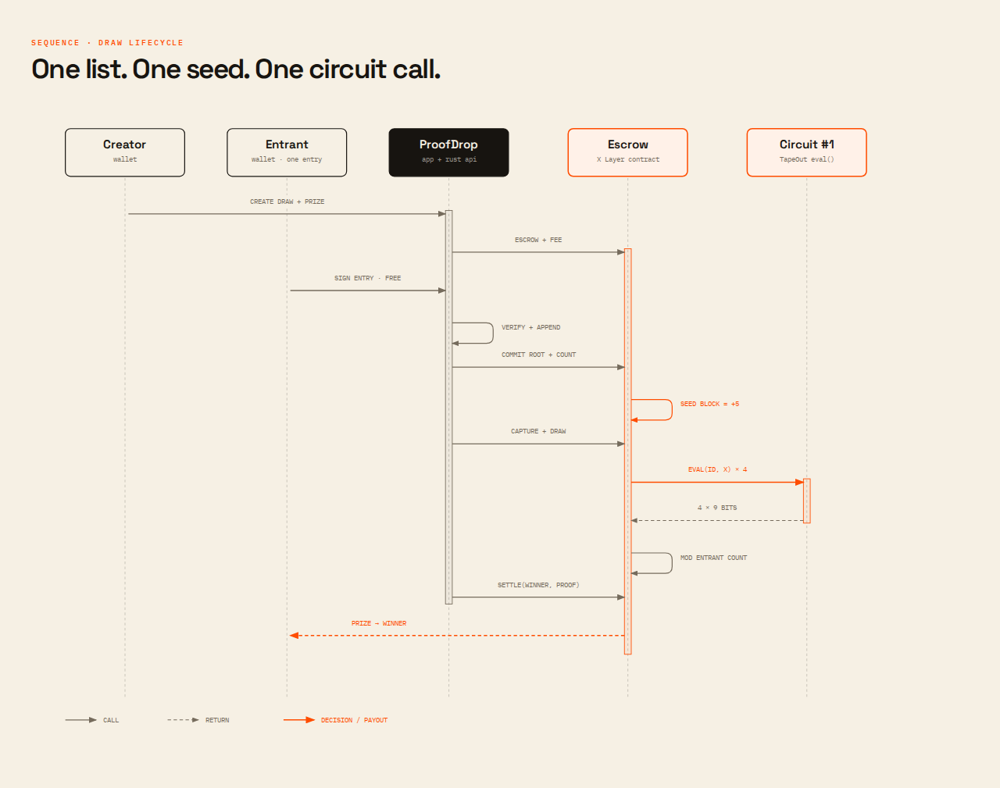

# ProofDrop

**Giveaways no one has to trust.**

ProofDrop is a verifiable giveaway protocol for creators. A creator escrows a prize on X Layer, entrants sign free entries, and a taped-out TapeOut circuit — not a server, not an oracle, not the creator — decides the winner. Every draw ends with a permanent proof page that anyone can replay.

- **Live app:** https://proofdrop-1xx.pages.dev
- **API:** https://proofdrop-api.fly.dev
- **Demo proof:** https://proofdrop-1xx.pages.dev/d/1/proof
- **Network:** X Layer mainnet (chain 196). The live draw is settled on mainnet and calls the real TapeOut circuit; see [Verification](#verification).
- **Source:** https://github.com/PhiBao/proofdrop
- **Built for:** X Layer TapeOut Accelerate (Build X Series), deadline Dec 7, 2026.

---

## The product

### Who it is for

Independent creators and Web3 communities who run recurring giveaways on X, Telegram, or Discord. They have an audience, a prize, and a reputation to protect. Their entrants have no reason to trust a screenshot.

### The problem

A giveaway is a promise with three failure points:

1. **Custody** — the prize may never be paid.
2. **Selection** — the winner may be hand-picked after entries close.
3. **Evidence** — a screenshot or a deleted post proves nothing.

Closed-source pickers, “random” comment tools, and spreadsheet screenshots are all unverifiable. RANDOM.ORG itself warns that screenshots and videos do not make a draw auditable. Creators get accused of rigging; entrants have no receipt.

### The insight

A giveaway does not have a randomness problem. It has a **custody + verifiability** problem. If the prize is escrowed, the entrant list is committed before the seed exists, and the selection function is public logic, then nobody needs to trust the operator. TapeOut makes that selection function a real on-chain circuit with a stable `eval()` interface. X Layer makes the escrow and payout cheap enough to run weekly.

### What is new

Before ProofDrop, a creator could choose between:

- a trusted platform (server-side picker, no proof), or
- a trusted oracle (VRF subscription, an abstraction you still trust).

ProofDrop makes the decision **legible and replayable**: the seed is a captured X Layer block hash, the entrant list is an index-bound Merkle root, and the winner index is the output of a taped-out NAND/LATCH circuit. The proof page prints every input, every output, and the command to re-run it. The page itself is a static build that can be published to DeWEB, where its bytes are verified against the chain.

---

## How a draw works

1. **Escrow.** The creator calls `createDraw(prize, closeTime, maxEntries, committer)` with the prize plus a 1% fee (minimum 0.0001 OKB). The contract holds the prize.
2. **Enter free.** An entrant signs a message binding their wallet to the draw. The API verifies the signature, de-duplicates the address, and appends it to the public list. No gas, no ticket price, no custody.
3. **Commit.** After the entry window closes, the list is hashed into a Merkle root and committed on-chain. The same transaction fixes a future `seedBlock = block.number + 5`.
4. **Seed.** Anyone calls `captureSeed` within the EVM’s 256-block window. The block hash is stored on-chain.
5. **Draw.** The contract derives four 17-bit inputs from the seed, calls the TapeOut circuit four times, concatenates the 9-bit outputs into a 36-bit accumulator, and takes it modulo the entrant count.
6. **Settle.** The winner (or anyone) submits a Merkle proof binding the winner address to the selected index. The contract verifies it and pushes the prize. If the winner is a contract that rejects the transfer, the prize is parked in `claimable` instead of locking.
7. **Prove.** The proof page publishes the seed, circuit ID, round inputs/outputs, accumulator, winner index, Merkle proof, and settlement transaction.

### The draw math

```text
seed        = blockhash(seedBlock)
for i in 0..4:
  x         = (seed >> (i * 17))
              ^ (drawId * 0x9E3779B97F4A7C15)
              ^ (i * 0x85EBCA6B)
  x        &= 0x1FFFF
  y[i]      = circuit.eval(circuitId, x)[0..2] & 0x1FF

accumulator = y[0] << 27 | y[1] << 18 | y[2] << 9 | y[3]
winnerIndex = accumulator % entryCount
```

The Merkle leaf is `keccak256(abi.encodePacked(uint32(index), winner))`. The proof is index-bound: a valid membership proof for a different index cannot settle the draw.

---

## Why TapeOut

TapeOut is the only stack where the selection function can be:

- **public** — the netlist and circuit ID are on X Layer;
- **deterministic** — `eval(circuitId, bytes)` returns the same bytes for the same input;
- **immutable** — the circuit is an NFT whose logic is burned into chain data;
- **cheap to call** — `eval` is a read-only call; the draw transaction pays gas for the gate execution;
- **legible** — the proof page can show the circuit ID and every round's bytes, not just “trust the RNG”.

The live deployment uses **ProofDrop Draw**, a processor we created on X Layer mainnet, and **circuit #1**, a 17-in / 9-out NAND-only mixer taped out on that processor. The circuit is a bijective 17-bit xorshift; its 9-bit projection is exactly uniform over 512 outputs. It has no state, no clock, and no external calls, so `eval` is deterministic and cheap. The processor and circuit ID are immutables in the escrow; the proof page publishes both. This is a dedicated draw circuit, not a borrowed general-purpose circuit.

> A circuit call is not a VRF. The seed is a block hash, and X Layer's block producer could theoretically influence it. The list is committed before the seed block exists, so the creator cannot choose a seed after seeing entries. This residual bias is disclosed on the proof page and in [Security](#security-model). It is a deliberate tradeoff for a transparent, replayable decision with no oracle dependency.

---

## Architecture

Two diagrams are included as self-contained HTML:

- [`architecture.html`](docs/diagrams/architecture.html) — wallets → app → Rust API → escrow → TapeOut circuit.
- [`draw-sequence.html`](docs/diagrams/draw-sequence.html) — the exact message order of a draw.
- [`lifecycle.html`](docs/diagrams/lifecycle.html) — every state and exit, including refunds.





```
Creator / Entrant wallets
        │  wallet writes (create, claim)        │  signed entries
        ▼                                       ▼
Static React app (Cloudflare Pages / DeWEB) ── Rust API (Axum + SQLx)
        │                                       │
        │                                       ├── SQLite: public entrant list, metadata
        │                                       └── orchestration: commit, capture, draw, settle
        ▼
ProofDrop escrow contract (X Layer)
        │  eval(circuitId, 3 bytes)
        ▼
ProofDrop Draw processor + circuit #1 (X Layer mainnet)
```

### Components

| Component | Implementation | Responsibility |
|---|---|---|
| Web app | React 19, Vite, TypeScript, wagmi/viem | Create/enter/claim, live draw stage, proof replay. Static build can be published to DeWEB. |
| API | Rust, Axum, Tokio, SQLx, alloy | Signature verification, entrant list, Merkle root, chain orchestration, proof reconstruction. |
| Escrow | Solidity 0.8.28, Foundry | Custody, commitment, seed capture, circuit call, Merkle settlement, refunds. |
| Circuit | ProofDrop Draw processor, circuit #1 | Dedicated 403-NAND, 17-in / 9-out draw mixer. |
| Database | SQLite (WAL) | Public entrant list, draw metadata, settlement tx hash. |
| Hosting | Cloudflare Pages (web), Fly.io (API) | Public demo; no server-side key handling in the browser. |

### Trust boundaries

- The **browser** never sees the orchestrator key.
- The **API** can append entries and submit permissionless transactions, but cannot move escrow funds or change a committed root.
- The **creator** can escrow, set metadata, and refund an empty/abandoned draw; they cannot change the list after commitment or pick the winner.
- The **contract** verifies the Merkle proof and the circuit output; it has no owner switch to redirect the prize.
- The **circuit** is public on-chain logic; it cannot call other contracts or mutate state.

---

## Repository map

```
apps/
  web/            React + Vite app, design system, proof pages
  api/            Rust Axum service, SQLite, chain orchestration
contracts/        Foundry project: ProofDrop.sol, MockProcessor.sol, tests, deploy script
circuit/          Notes and verification helpers for the TapeOut circuit
docs/diagrams/    Self-contained architecture, sequence, lifecycle diagrams
scripts/          Demo seeding, icon generation
```

---

## Running locally

### Prerequisites

- Node.js ≥ 22, pnpm 11
- Rust ≥ 1.85 (nightly compatible), cargo
- Foundry (`forge`, `cast`, `anvil`)
- An X Layer RPC (testnet or mainnet) and a funded deployer key for transactions

### 1. Contracts

```bash
cd contracts
git clone --depth 1 https://github.com/foundry-rs/forge-std lib/forge-std
forge test
```

Deploy to X Layer testnet with the mock processor:

```bash
cd contracts
export PRIVATE_KEY=0x...
export DEPLOY_MOCK=true
export CIRCUIT_ID=1
export FEE_BPS=100
export MIN_FEE=1000000000000000
export ROUNDS=4
forge script script/Deploy.s.sol \
  --rpc-url https://testrpc.xlayer.tech/terigon --broadcast
```

Deploy to X Layer mainnet with the live TapeOut circuit:

```bash
./scripts/deploy-mainnet.sh
```

The script reads `.secrets/deployer.env`, refuses to run below 0.008 OKB, deploys with processor `0xfdba…7cac` and circuit `1`, and writes the resulting address to `.secrets/mainnet-contract.env`.

**Mainnet status:** the dedicated processor is [`0xfdbab…7cac`](https://www.okx.com/web3/explorer/xlayer/address/0xfdbab05882fad8556e4f64f74e8532e95cce7cac) (ProofDrop Draw, 10,000-transistor supply; circuit #1 burned 403 NAND). The escrow is [`0x2D2d…eBb`](https://www.okx.com/web3/explorer/xlayer/address/0x2D2d8bba04Ed8aF72d989b172725B447D4954eBb). Draw #1, “First Silicon,” is settled and paid. The earlier FabX circuit #24 proof is archived at [`docs/proofs/tapeout-24-draw-1.json`](docs/proofs/tapeout-24-draw-1.json); the testnet mock is historical.

The fork test `testRealCircuitPreview` proves the real circuit integration and measures the call path:

```bash
forge test --match-contract ProofDropForkTest -vv --fork-url https://rpc.xlayer.tech
```

### 2. API

```bash
cd apps/api
cp .env.example .env       # fill in values
cargo run
```

Required variables:

| Variable | Example | Notes |
|---|---|---|
| `PORT` | `8090` | API port |
| `DATABASE_URL` | `sqlite://data/proofdrop.db` | SQLite path |
| `RPC_URL` | `https://rpc.xlayer.tech` | X Layer RPC |
| `CHAIN_ID` | `196` | 196 mainnet, 1952 testnet |
| `CONTRACT_ADDRESS` | `0x2D2d…eBb` | deployed ProofDrop |
| `PROCESSOR_ADDRESS` | `0xfdba…7cac` | ProofDrop Draw processor used by the proof endpoint |
| `CIRCUIT_ID` | `1` | ProofDrop Draw circuit |
| `EXPLORER_URL` | `https://www.okx.com/web3/explorer/xlayer` | explorer base |
| `PRIVATE_KEY` | `0x…` | orchestrator key (server-only) |
| `PUBLIC_BASE_URL` | `https://proofdrop-api.fly.dev` | links |
| `DEMO_MODE` | `false` | `true` shows the rehearsal banner on a testnet deployment |
| `ADMIN_TOKEN` | random hex | enables the recovery import endpoint; omit to disable |

`ADMIN_TOKEN` is not needed for the public flow. It powers `POST /admin/import`, an operational recovery tool that restores metadata/entries and refuses to commit if the rebuilt Merkle root does not match the on-chain root.

### 3. Web

```bash
cd apps/web
pnpm install
VITE_API_URL=http://localhost:8090 pnpm dev
```

The Vite dev server proxies `/api` to `http://localhost:8090` when `VITE_API_URL` is unset. Production build:

```bash
VITE_API_URL=https://proofdrop-api.fly.dev \
VITE_CHAIN_ID=196 \
VITE_CONTRACT_ADDRESS=0x2D2d8bba04Ed8aF72d989b172725B447D4954eBb \
VITE_RPC_URL=https://rpc.xlayer.tech \
VITE_EXPLORER_URL=https://www.okx.com/web3/explorer/xlayer \
pnpm build
```

For a DeWEB-compatible build (relative assets, hash routing):

```bash
VITE_BASE=./ VITE_HASH_ROUTER=1 pnpm build
```

### 4. Tests

```bash
forge test --root contracts
cargo test --manifest-path apps/api/Cargo.toml
pnpm --dir apps/web build
```

---

## Verification

This section is intentionally blunt. The hackathon rules prohibit presenting simulated behavior as real.

### What is real and live

| Claim | Evidence |
|---|---|
| Prize escrow and settlement | `ProofDrop` on X Layer mainnet: [`0x2D2d8bba04Ed8aF72d989b172725B447D4954eBb`](https://www.okx.com/web3/explorer/xlayer/address/0x2D2d8bba04Ed8aF72d989b172725B447D4954eBb) |
| Draw #1 entrant root | `0xf502b58a94a6543bede59637252bf74b9dc67c8616a16556a98573de314018cf` |
| Draw #1 seed block | `75174147` |
| Draw #1 seed | `0x3b6ce50309ca7131af912ed917cc450e53fe437f6c9cfb1f8e53decaf6da1e6e` |
| Draw #1 winner | index `0` → `0x2516f212e268708ee4a121f44e58ff4ffa68d628` |
| Processor + circuit tape-out | “ProofDrop Draw” `0xfdbab…7cac`, circuit `#1`, 403 NAND burned; tx [`0xdc323697f58d3f1d3c6836b8126fbb22dd3847dd9ba0f695137edbf90795c9ca`](https://www.okx.com/web3/explorer/xlayer/tx/0xdc323697f58d3f1d3c6836b8126fbb22dd3847dd9ba0f695137edbf90795c9ca) |
| Processor registration | `isCPU(0xfdbab…7cac)` on the X Layer TapeOut factory returns true |
| Draw #1 create tx | [`0x82f3aa902c377e2df894f391623ec9d46693edd349ac3f66536935eb3e107821`](https://www.okx.com/web3/explorer/xlayer/tx/0x82f3aa902c377e2df894f391623ec9d46693edd349ac3f66536935eb3e107821) |
| Draw #1 commit tx | [`0x2d7c0d7b0a50507a8d67cf093c287ebe22d9a0e0f7cc8dbfa89acc7b34eedc38`](https://www.okx.com/web3/explorer/xlayer/tx/0x2d7c0d7b0a50507a8d67cf093c287ebe22d9a0e0f7cc8dbfa89acc7b34eedc38) |
| Draw #1 draw tx | [`0xb8544249e4b036d459ade9b6d1d342892fb9e0c422f692b52b6d5d360255cb6d`](https://www.okx.com/web3/explorer/xlayer/tx/0xb8544249e4b036d459ade9b6d1d342892fb9e0c422f692b52b6d5d360255cb6d) |
| Draw #1 settlement tx | [`0x95f202eb4a244fee0ea9d863cdce5dc5c586afb28b97d513713983de51b4d46f`](https://www.okx.com/web3/explorer/xlayer/tx/0x95f202eb4a244fee0ea9d863cdce5dc5c586afb28b97d513713983de51b4d46f) |
| Free signed entries | 3 public entries; signatures verified server-side; one address per draw |
| Merkle commitment + proof | Index-bound root committed on-chain; proof page prints the full proof |
| Proof page | Public at https://proofdrop-1xx.pages.dev/d/1/proof |
| Proof survival | The proof page ships with a static JSON fallback at `/proofs/1.json` and a DeWEB copy at https://1-2-413.tapekit.org. |
| DeWEB proof | Name `1.2.413.tape`, container `0xa5bfe431…535c`, one file `index.html` (11,137 bytes, sha256 `0x1e3c…de0d`). `isLive` and `isContainerLive` return true. |
| DeWEB transactions | [open](https://www.okx.com/web3/explorer/xlayer/tx/0x9470d6c5d57b5ed801191ee4329a2ead960876690f77884ee1cb965e6c7ea541) · [publish](https://www.okx.com/web3/explorer/xlayer/tx/0xe947a006c51c4f5fcdd63197e1b3f3cd00072952f787e756bce21be682bc29c1) · [bind](https://www.okx.com/web3/explorer/xlayer/tx/0x6f26821a4aa02a51f5a27f10100d6063c2b49a19491d5d174c790f4cf37f2835) |
| Open judge draw | #2 “The Open Draw”, 0.002 OKB, 30-day window, 3 entries: https://proofdrop-1xx.pages.dev/d/2 |
| Rust API | https://proofdrop-api.fly.dev/health |

### What is real vs simulated

| Claim | Status |
|---|---|
| Live path | Real: prize escrow, entry signatures, Merkle commitment, seed capture, circuit call, payout, and proof page are X Layer mainnet transactions. |
| Circuit evaluation | Real ProofDrop Draw processor `0xfdbab05882fad8556e4f64f74e8532e95cce7cac`, circuit `1`, 403 NAND gates. Round 0 input `0x7b6200` returns `0x7d01`; round 3 input `0x9ed200` returns `0x5901`. |
| Earlier mainnet rehearsal | The first proof used FabX circuit #24 (`0x87BF…F9a6`) and escrow `0xc3cF…41d9`; it is archived at [`docs/proofs/tapeout-24-draw-1.json`](docs/proofs/tapeout-24-draw-1.json). |
| Earlier testnet rehearsal | Historical only. It used `MockProcessor` `0x1f27…71a2` and testnet escrow `0xC56d…530a`; it is not the live app. |
| DeWEB hosting | Live for the proof page at https://1-2-413.tapekit.org. The container was opened with the official opener, the 11,137-byte page was written to SiteRegistry, and the name `1.2.413.tape` is bound. The interactive app remains on Cloudflare Pages. |
| Sybil resistance | One address per draw, signature verification, and off-chain abuse controls. Not perfect sybil resistance; disclosed. |
| Block-producer neutrality | Not claimed. The list is committed before the seed block, but X Layer’s block producer could influence the hash. Disclosed on the proof page. |

### Reproduce the draw

```bash
# 1. Read the committed draw
cast call 0x2D2d8bba04Ed8aF72d989b172725B447D4954eBb \
  "getDraw(uint256)((address,address,address,uint256,uint64,uint64,uint32,uint32,uint32,uint8,bool,bool,bool,bytes32,bytes32))" \
  1 --rpc-url https://rpc.xlayer.tech

# 2. Re-run the real circuit for round 0
cast call 0xfdbab05882fad8556e4f64f74e8532e95cce7cac \
  "eval(uint256,bytes)(bytes)" 1 0x7b6200 \
  --rpc-url https://rpc.xlayer.tech
# -> 0x7d01

# 3. Re-run round 3
cast call 0xfdbab05882fad8556e4f64f74e8532e95cce7cac \
  "eval(uint256,bytes)(bytes)" 1 0x9ed200 \
  --rpc-url https://rpc.xlayer.tech
# -> 0x5901
```

The proof page publishes the four round inputs, outputs, 9-bit values, accumulator, winner index, Merkle proof, and settlement link.

---

## Demo flow (3 minutes)

1. **Hook (0:00–0:20).** “A creator was accused of rigging a giveaway. A screenshot cannot prove otherwise.”
2. **Create + escrow (0:20–0:50).** Open `/create`, enter a prize, sign `createDraw`, show the escrow transaction on OKX Explorer.
3. **Enter (0:50–1:20).** Open the draw link on a phone, connect OKX Wallet, sign a free entry. Show the public entrant list.
4. **Lock + draw (1:20–1:50).** Close entries, lock the list, run the draw. The contract captures the seed block, calls circuit #1, and settles the winner.
5. **The moment (1:50–2:20).** Open the proof page. Replay the four circuit rounds; show the same winner index and the settlement transaction.
6. **Business + close (2:20–3:00).** 1% fee, recurring creator drops, DeWEB proof page. “Don’t trust the draw. Replay it.”

A rehearsal script is included: [`scripts/seed-demo.sh`](scripts/seed-demo.sh). The full shot list is in [`docs/demo-script.md`](docs/demo-script.md); paste-ready submission copy is in [`docs/submission.md`](docs/submission.md).

---

## Security model

### Escrow

- `createDraw` requires `msg.value == prize + fee`; the fee is sent to the treasury in the same transaction.
- The prize is held by the contract, not by ProofDrop.
- `settle` verifies an index-bound Merkle proof before transferring. State is updated before the external call and the function is `nonReentrant`.
- If the winner rejects the transfer, the prize is credited to `claimable` instead of reverting the draw.
- `refund` is creator-only and only for an empty draw, or a committed draw that was never executed after 30 days.

### Entries

- Every entry is an EIP-191 signature over `drawId`, `chainId`, contract address, and entrant address. The API verifies the recovered signer.
- The signed message is bound to one draw and one deployment; replaying it on another draw or chain fails.
- One address per draw (`PRIMARY KEY (draw_id, address)`).
- Entries close on-chain time; the API rejects late signatures and a committed root freezes the list.

### Seed

- The seed block is fixed at commitment (`block.number + 5`).
- The seed block hash must be captured within 256 blocks. If capture is missed, the draw cannot execute and the creator can refund after 30 days.
- The creator cannot choose a new seed after seeing the entrant list.

### Operations

- The orchestrator key is server-side only (Fly secret). It can submit permissionless transactions but cannot move escrow funds.
- The API has no authentication for public reads/writes; writes require wallet signatures. CORS is open for the public demo, but there are no cookies or ambient credentials.
- `ADMIN_TOKEN` gates the recovery import endpoint; it is not used by the public flow.
- SQLite runs with WAL and a single writer connection, which keeps entry index assignment serialized.

### Known risks

- **Block-producer bias.** A block producer can influence the seed block. The list is committed first, which removes creator choice; it does not remove miner/sequencer influence.
- **Processor implementation.** The processor is registered with the X Layer TapeOut factory, but the factory is unsealed at the time of writing. The processor/circuit implementation should be treated as upgradeable until sealed. The circuit netlist, processor address, and eval results are public; high-value draws should pin and verify the implementation before escrow.
- **Off-chain list custody.** The public list lives in SQLite; the on-chain root is the source of truth. The recovery endpoint can rebuild the list only if the entries are supplied and the root matches. A lost list means the proof page cannot reconstruct the Merkle proof until restored.
- **Prize promotion rules.** Entries are free. Do not use ProofDrop for paid-entry lotteries or regulated gambling without legal review.

---

## Testing

| Suite | What it covers |
|---|---|
| `contracts/test/ProofDrop.t.sol` | Fee/escrow accounting, commit authorization, draw + settle + claim, rejecting winner fallback, invalid proof, seed expiry, refunds, preview determinism |
| `contracts/test/ProofDropFork.t.sol` | Real TapeOut circuit call on an X Layer mainnet fork; gas measurement |
| `apps/api/src/merkle.rs` tests | Index-bound Merkle construction and proof verification |
| `pnpm --dir apps/web build` | TypeScript strict build, static asset generation |
| Manual E2E | Create → 3 signed entries → commit → capture → draw → settle → proof replay on X Layer mainnet |

Run everything:

```bash
forge test --root contracts
cargo test --manifest-path apps/api/Cargo.toml
pnpm --dir apps/web build
```

---

## Limitations and roadmap

### Current limitations

- One settled custom-circuit draw plus one open 30-day draw at submission time; the landing features the open draw.
- Wallet-only entry (no X-handle entry or social login yet).
- One winner per draw; no multi-winner or NFT prize support.
- SQLite is appropriate for a single-instance demo, not a multi-region production service.
- The full interactive app is on Cloudflare Pages; the DeWEB copy is the static proof page. The container opener cost 0.08 OKB, paid once.
- No independent security audit.

### Next steps

1. Run recurring mainnet draws and keep one open for the submission window.
2. Tape out a dedicated draw circuit (16-bit xorshift + rejection) and publish its processor address and circuit ID.
3. Publish the full interactive app to DeWEB; the static proof page is already live at 1-2-413.tapekit.org.
4. Add X-handle + wallet entry with Turnstile and a signed entry receipt.
5. Add multi-winner draws and ERC-20/NFT prizes.
6. Move the indexer to Postgres and add event-based reconciliation.
7. Independent audit of the escrow and the draw math.

---

## Hackathon relevance

**Event:** X Layer TapeOut Accelerate (Build X Series), 100,000 USDT pool, submission deadline Dec 7, 2026.

**Direction:** consumer/creator application built on the TapeOut ecosystem, not a protocol demo.

**TapeOut usage:**

- The draw calls a real TapeOut processor on X Layer mainnet: `0xfdbab05882fad8556e4f64f74e8532e95cce7cac`, circuit `#1`.
- The circuit ID and processor are contract immutables; the proof page publishes them.
- The static build is designed for DeWEB (relative assets, hash-routing option) and the proof page is intended to be the undeletable artifact.
- FabX’s DeWEB and mining-weight incentives offer a natural distribution loop: a popular proof page drives traffic to the creator’s DeWEB, which can boost the tied miner’s weight.

**Judging fit:**

| Criterion | How ProofDrop answers it |
|---|---|
| User value & commercial potential | Creators pay 1% to protect reputation and increase entries; recurring weekly drops; visible fee. |
| Innovation | Circuit-decided fairness + escrow + permanent replayable proof, not a VRF wrapper. |
| Ecosystem integration | Real TapeOut circuit ID, X Layer escrow, DeWEB-ready static proof page, FabX ecosystem. |
| Readiness & UX | Working end-to-end flow, free entry, mobile-friendly proof page, failure states, public API. |
| Demo | One judge action (enter) plus one replay (proof page) makes the thesis obvious in under a minute. |

**Revenue model:** 1% of the prize, minimum 0.0001 OKB, charged at escrow. Entrants pay nothing. The fee is visible before signature and is sent to the treasury in the creation transaction.

---

## License

MIT for code. Diagram and documentation text CC0.
